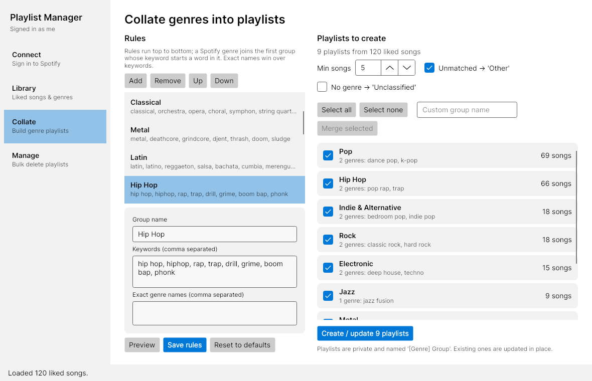
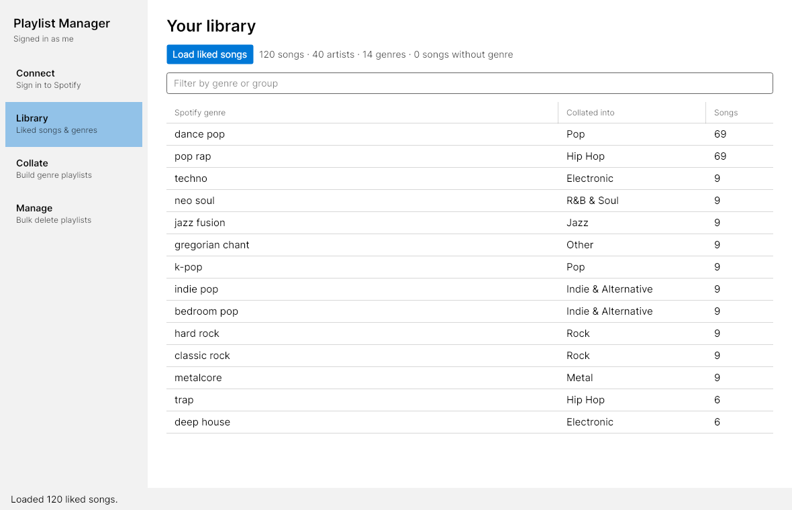
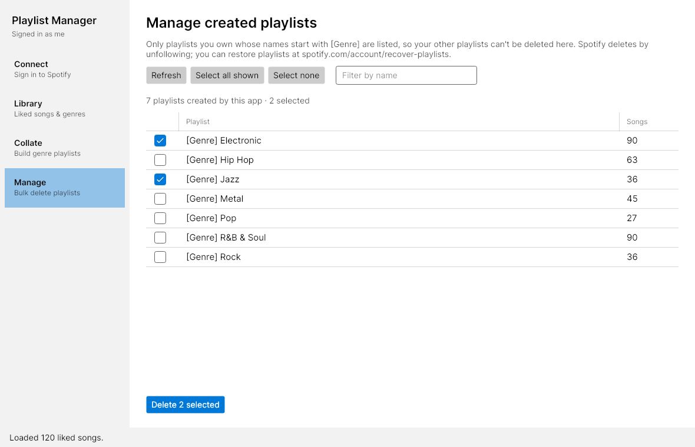

# SpotifyPlaylistService

A C# library and cross-platform desktop app (Linux and Windows) for organising your Spotify liked songs into genre playlists, collating Spotify's hundreds of micro-genres into a manageable set, and bulk-deleting the playlists it created.



## Features

- 🖥️ **Desktop app (Avalonia)** - Native UI on Linux and Windows (macOS should work too, untested)
- 🎛️ **Genre collation** - "bedroom pop", "k-pop" and "dance pop" become one **Pop** playlist, driven by editable rules
- 🧩 **Custom groups** - Tick several groups and merge them into your own (e.g. "Heavy" = Metal + Punk)
- 🗑️ **Safe bulk delete** - Multi-select delete that can only touch playlists you own that this app created
- ❤️ **Liked Songs Integration** - Add tracks from playlists to your liked songs
- 🔐 **PKCE sign-in** - Only a Client ID is needed, no client secret stored; the session is remembered between launches
- ⚡ **Resilient API layer** - Automatic 429 back-off, token refresh on 401 and an on-disk artist-genre cache

## Desktop app

### 1. Set up a Spotify app (once)
1. Go to the [Spotify Developer Dashboard](https://developer.spotify.com/dashboard) and create an app (choose **Web API**)
2. Add the redirect URI `http://127.0.0.1:8888/callback`
3. Copy the **Client ID** (the client secret is not needed)

> Since February 2026, Spotify development-mode apps require the app owner to have **Spotify Premium** and allow up to **5 users** (added under *User Management* in the dashboard).

### 2. Run it
Requires the [.NET 8 SDK](https://dotnet.microsoft.com/download).

```bash
dotnet run --project src/SpotifyPlaylistService.Desktop
```

Or build a standalone executable (no .NET install needed on the target machine):

```bash
# Windows
dotnet publish src/SpotifyPlaylistService.Desktop -c Release -r win-x64 --self-contained -p:PublishSingleFile=true -p:IncludeNativeLibrariesForSelfExtract=true
# Linux
dotnet publish src/SpotifyPlaylistService.Desktop -c Release -r linux-x64 --self-contained -p:PublishSingleFile=true -p:IncludeNativeLibrariesForSelfExtract=true
```

The executable is `SpotifyPlaylistManager(.exe)` under `src/SpotifyPlaylistService.Desktop/bin/Release/net8.0/<rid>/publish/`.

### 3. Use it

| Page | What it does |
|------|--------------|
| **Connect** | Paste your Client ID and sign in through the browser. Set `SPOTIFY_CLIENT_ID` to prefill it. |
| **Library** | Loads liked songs and each artist's genres, and shows which group every Spotify genre collates into. |
| **Collate** | Edit the rules, preview the resulting playlists, merge groups, and create/update the ticked ones. |
| **Manage** | Lists playlists created by this app. Filter, multi-select and delete them in one go. |

<p>
  
  
</p>

### How genre collation works

Spotify tags artists (not tracks) with very specific genres. Rules map them to parent groups:

- Rules are checked **top to bottom**; a genre joins the **first** group with a matching keyword, so specific groups (Metal) sit above generic ones (Rock).
- A **keyword** matches when a word in the genre starts with it: `metal` matches `nu metal` and `metalcore`, while `rap` does not match `scrap`.
- **Exact** names always win over keywords, e.g. `dub` -> Reggae even though `dubstep` -> Electronic.
- A song joins every group one of its genres maps to (`pop rock` and `hard rock` artists can land in both Pop and Rock).
- Unmatched genres go to **Other**; songs whose artist has no genre can go to **Unclassified**; groups below **Min songs** are skipped.
- **Merge selected** adds a top-priority rule claiming all genres of the ticked groups.

Rules are stored as JSON and can be edited in the app or by hand:

| OS | Location |
|----|----------|
| Linux | `~/.config/SpotifyPlaylistService/genre-rules.json` |
| Windows | `%APPDATA%\SpotifyPlaylistService\genre-rules.json` |

The same folder holds `artist-genres.json` (30-day cache that makes re-scans fast) and `session.json` (Client ID and refresh token, readable only by your user on Linux). Delete `session.json` or use **Sign out** to forget the login.

### Bulk delete safety

- Only playlists **owned by you** whose names start with **`[Genre]`** are listed or deletable; the library re-checks this on every delete, so other playlists are skipped even if passed in.
- Deleting more than 10 playlists requires typing `DELETE`.
- Spotify has no hard delete: playlists are removed from your library and can be restored at [spotify.com/account/recover-playlists](https://www.spotify.com/account/recover-playlists/).

## Library usage

```csharp
using SpotifyPlaylistService.Models;
using SpotifyPlaylistService.Services;
using SpotifyPlaylistService.Storage;

var auth = new SpotifyAuthService(new JsonSessionStore());
var manager = new SpotifyManagerService(new SpotifyApiService(), new JsonArtistGenreCache());

if (!await auth.TryRestoreSessionAsync())
    await auth.AuthenticateWithPkceAsync("YOUR_CLIENT_ID");

await manager.InitializeAsync(auth); // also wires automatic token refresh

var progress = new Progress<OperationProgress>(p => Console.WriteLine(p.Message));
var tracks = await manager.GetLikedSongsWithGenresAsync(progress);

// Collate into parent genres and create one playlist per group
var groups = manager.CollateGenres(tracks, new GenreRuleStore().Load());
await manager.CreateCollatedPlaylistsAsync(groups, progress);

// Bulk delete everything this library created
var result = await manager.DeleteGenrePlaylistsAsync(await manager.GetGenrePlaylistsAsync(), progress);
Console.WriteLine($"Deleted {result.Deleted.Count}, failed {result.Failed.Count}");
```

The console app (`dotnet run --project src/SpotifyPlaylistService.Console`) offers the same operations as a text menu.

### Main types

| Type | Role |
|------|------|
| `SpotifyAuthService` | PKCE (or legacy client-secret) OAuth via a loopback listener; session persistence and token refresh |
| `SpotifyApiService` | Low-level Web API calls; uses `SpotifyHttpHandler` for 429/5xx retry and 401 refresh |
| `SpotifyManagerService` | Orchestration: liked songs with genres, collated playlist sync, safe bulk delete |
| `GenreCollator` / `GenreRuleSet` | Pure, unit-tested genre-to-group mapping |
| `GenreRuleStore`, `JsonArtistGenreCache`, `JsonSessionStore` | Per-user JSON storage |

## Project Structure

```
SpotifyPlaylistService/
├── src/
│   ├── SpotifyPlaylistService/            # Library (net8.0)
│   │   ├── Http/                          # SpotifyHttpHandler, SpotifyApiException
│   │   ├── Model/                         # Tracks, playlists, genre rules/groups, progress
│   │   ├── Services/                      # Auth, API, manager, Collation/GenreCollator
│   │   └── Storage/                       # Rule, artist-genre cache and session stores
│   ├── SpotifyPlaylistService.Console/    # Text-menu app
│   └── SpotifyPlaylistService.Desktop/    # Avalonia desktop app (MVVM)
│       ├── ViewModels/                    # Testable, no window code
│       ├── Views/                         # XAML
│       └── Services/                      # Dialog abstraction
├── tests/
│   └── SpotifyPlaylistService.Tests/      # xUnit + Avalonia headless UI tests
└── SpotifyPlaylistService.sln
```

## Development

```bash
dotnet build
dotnet test                                    # unit, view model and headless UI tests
SCREENSHOT_DIR=/tmp/shots dotnet test          # also saves a PNG of each page
```

## Requirements

- .NET 8.0 SDK
- Spotify Developer app (owner needs Premium for development mode)
- Required Scopes:
  - `user-library-read`
  - `user-library-modify`
  - `playlist-read-private`
  - `playlist-read-collaborative`
  - `playlist-modify-public`
  - `playlist-modify-private`

## Limitations

- **Spotify API changes (February 2026)**: the library targets the updated development-mode endpoints (`/me/playlists`, `/playlists/{id}/items`, `/me/library`). The batch artists endpoint was removed, so the first genre scan makes one request per artist; later scans use the cache.
- **Playlist Folders**: Spotify's public API does not support folder operations. Genre playlists use the `[Genre]` naming convention for manual organization.
- **Genre Detection**: Genres come from the track's first artist, and many artists have no genres at all (see the Library page's "songs without genre" count).

## Contributing

Contributions are welcome! Please feel free to submit a Pull Request.

1. Fork the repository
2. Create your feature branch (`git checkout -b feature/AmazingFeature`)
3. Commit your changes (`git commit -m 'Add some AmazingFeature'`)
4. Push to the branch (`git push origin feature/AmazingFeature`)
5. Open a Pull Request

## License

This project is licensed under the MIT License - see the [LICENSE](LICENSE) file for details.

## Acknowledgments

- Built with [Spotify Web API](https://developer.spotify.com/documentation/web-api/)
- Inspired by the need for better playlist organization

## Support

- 📫 Report issues: [GitHub Issues](https://github.com/yourusername/SpotifyPlaylistService/issues)
- 📖 Documentation: [Wiki](https://github.com/yourusername/SpotifyPlaylistService/wiki)
- 💬 Discussions: [GitHub Discussions](https://github.com/yourusername/SpotifyPlaylistService/discussions)

---

**Note**: This library is not affiliated with Spotify AB. Spotify is a trademark of Spotify AB.